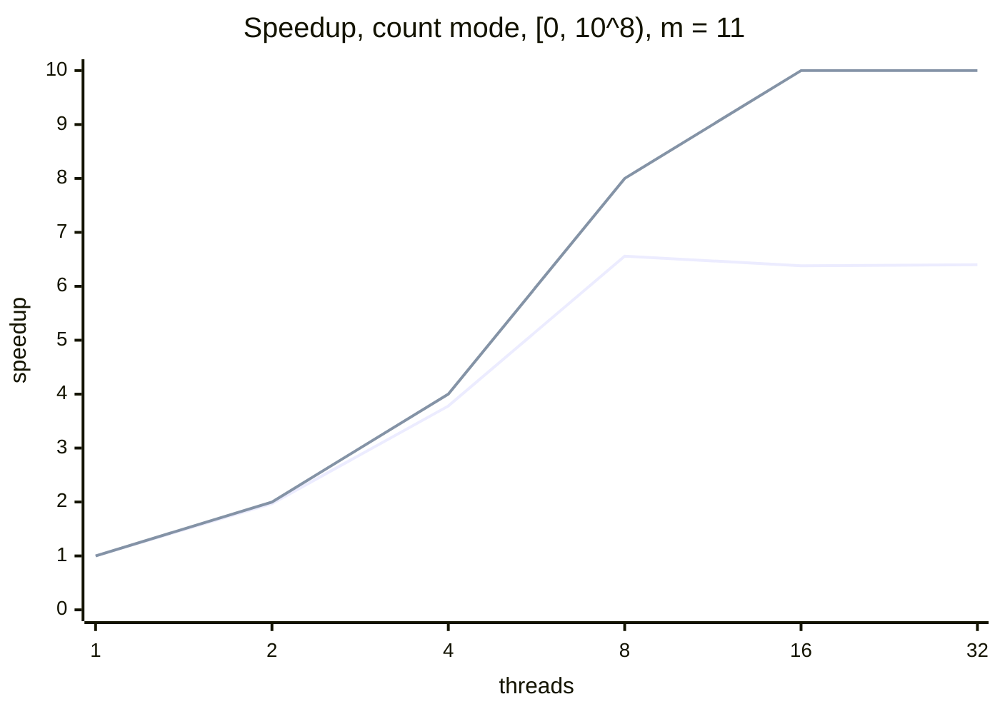

# Measurements

Every optimisation in this project is measured against the previous version, so its effect can be shown rather than assumed. This file records how the measurements are taken and what they show.

## Method

| Aspect | Choice | Reason |
|---|---|---|
| Tool | [Google Benchmark](https://github.com/google/benchmark) v1.10.0, fetched by CMake | The standard library for C++ micro-benchmarks, from the same team as GoogleTest. It repeats each measurement until it is stable and reports the spread. |
| Build | Release, with `-DIBAN_BUILD_BENCHMARKS=ON` | Debug code is not optimised; its timings do not represent the real program. |
| Workload | Count mode on `[0, 10⁸)` with `m = 11`, for 1 to 12, 16 and 32 threads | Large enough that starting threads is negligible next to the work. Every count up to 12 shows where all cores are in use; 16 and 32 show more threads than cores. |
| Time | Wall-clock time (`UseRealTime`) | The default CPU time only covers the calling thread, which just waits for the workers. Wall-clock time is what the user waits. |
| Repeats | 5 repetitions, median reported | One slow run (another program using the CPU) does not distort the result. The coefficient of variation (cv) shows how stable the runs were. |
| Correctness | Checked by the unit tests (`ParallelCount.MatchesSequentialForEveryThreadCount`) | A benchmark measures time only; correctness is the job of the tests. |
| Conditions | Laptop on mains power, other programs closed | Battery saving and background load change the clock speed. |

**Speedup** = median time with 1 thread / median time with p threads.
**Efficiency** = speedup / p; 100% means every thread does useful work all the time.

### Commands

```bash
cmake --preset release -DIBAN_BUILD_BENCHMARKS=ON
cmake --build --preset release
./build/release/iban_benchmark --benchmark_repetitions=5 --benchmark_report_aggregates_only=true
```

Use the `real_time_median` rows; the `CPU` column is the time of the waiting main thread and is not used.

## Machine

| | |
|---|---|
| Computer | <fill in: `sysctl -n machdep.cpu.brand_string`> |
| Cores | 10 (<fill in: `sysctl hw.perflevel0.physicalcpu hw.perflevel1.physicalcpu` gives performance and efficiency cores>) |
| Compiler | <fill in: `c++ --version`> |
| Date | <fill in> |

The benchmark also prints the number of CPUs and the cache sizes at the top of its output.

## Step 4: parallel count, one result slot per thread

### First measurement (2026-11-13, thread counts 1, 2, 4, …, 32)

Measured with background load (load average about 12), so the numbers are somewhat pessimistic.

| Threads | Median (ms) | cv | Speedup | Efficiency |
|---:|---:|---:|---:|---:|
| 1 | 579 | 1.9% | 1.00 | 100% |
| 2 | 294 | 0.4% | 1.97 | 98% |
| 4 | 153 | 2.5% | 3.78 | 95% |
| 8 | 88.2 | 5.6% | 6.56 | 82% |
| 16 | 90.8 | 7.0% | 6.38 | 40% |
| 32 | 90.4 | 6.2% | 6.40 | 20% |

The first line is the measured speedup, the second the ideal speedup (equal to the number of threads, at most 10 cores):



### Second measurement (<fill in date>, thread counts 1 to 12, 16, 32, low background load)

| Threads | Median (ms) | cv | Speedup | Efficiency |
|---:|---:|---:|---:|---:|
| 1 | | | 1.00 | 100% |
| 2 | | | | |
| 3 | | | | |
| 4 | | | | |
| 5 | | | | |
| 6 | | | | |
| 7 | | | | |
| 8 | | | | |
| 9 | | | | |
| 10 | | | | |
| 11 | | | | |
| 12 | | | | |
| 16 | | | | |
| 32 | | | | |

### Observations

<fill in after measuring; points to look for:>

- **Up to the number of performance cores**: the speedup should be close to the number of threads, because the threads share nothing while they run.
- **Efficiency cores**: Apple Silicon has performance and efficiency cores. Threads on efficiency cores are slower, so the speedup grows less steeply once the performance cores are in use.
- **More threads than cores**: no further gain, because the cores are already busy; the operating system switches between threads instead.
- **Small ranges**: with the assignment example (20 numbers), more threads are slower, because starting a thread costs more than checking 20 numbers.

## Runs in CI

Every pull request also builds the benchmark and runs each thread count once (`benchmark (smoke run)` in the CI workflow). This only checks that the benchmark still builds and runs. The results are shown as a table on the Summary page of the run and kept as the artifact `benchmark-ubuntu` (JSON), but they are **indicative only**: CI runners are shared virtual machines with few cores and varying hardware, so their timings are not used for the conclusions in this file.

## References

The benchmark follows the official Google Benchmark documentation. After a build with `-DIBAN_BUILD_BENCHMARKS=ON`, the documentation of the exact version used is also available locally in `build/release/_deps/googlebenchmark-src/docs/`.

| Topic | Source | Used for |
|---|---|---|
| Basic structure, CMake integration | [Google Benchmark README](https://github.com/google/benchmark#readme), sections *Usage* and *Usage with CMake* | `benchmark::State`, the measuring loop, `BENCHMARK_MAIN`, `FetchContent` |
| Thread counts as arguments | [User Guide](https://github.com/google/benchmark/blob/main/docs/user_guide.md), *Passing Arguments* | `Range(1, 32)` with `RangeMultiplier(2)` |
| Wall-clock time for code that starts threads | User Guide, *CPU Timers* | `UseRealTime()`: the default CPU timer only measures the main thread |
| Keeping the work from being optimised away | User Guide, *Preventing Optimization* | `benchmark::DoNotOptimize` |
| Repetitions, median and spread | User Guide, *Statistics: Reporting the Mean, Median and Standard Deviation* | `--benchmark_repetitions`, `--benchmark_report_aggregates_only` |
| Stable measurements | [Reducing Variance](https://github.com/google/benchmark/blob/main/docs/reducing_variance.md) | The *Conditions* row of the method |
| Why the speedup levels off | [Amdahl's law](https://en.wikipedia.org/wiki/Amdahl%27s_law) | Interpreting the observations |
| Measuring C++ code in general | Chandler Carruth, *Tuning C++: Benchmarks, and CPUs, and Compilers! Oh My!*, CppCon 2015 | Background on benchmarks and `DoNotOptimize` |