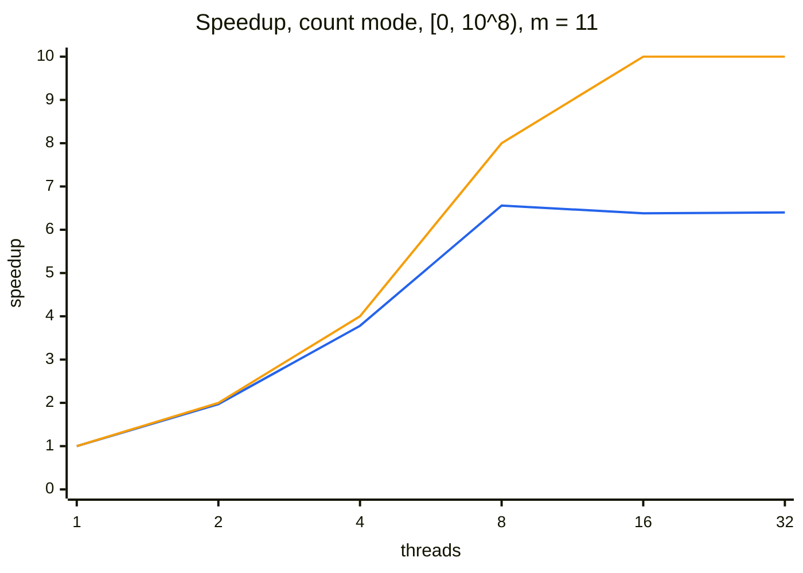
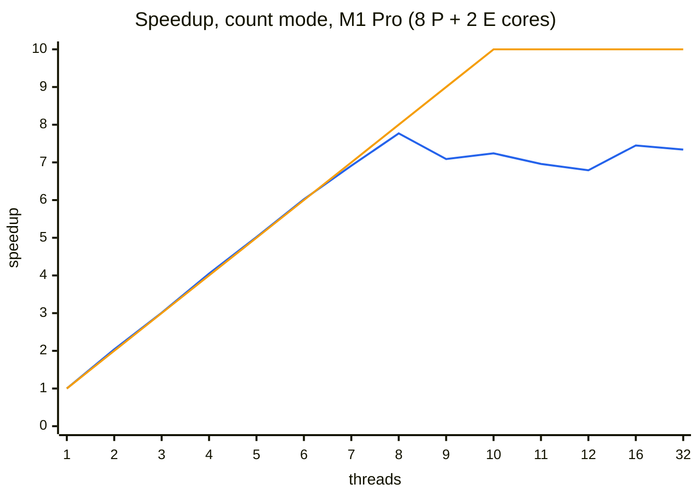
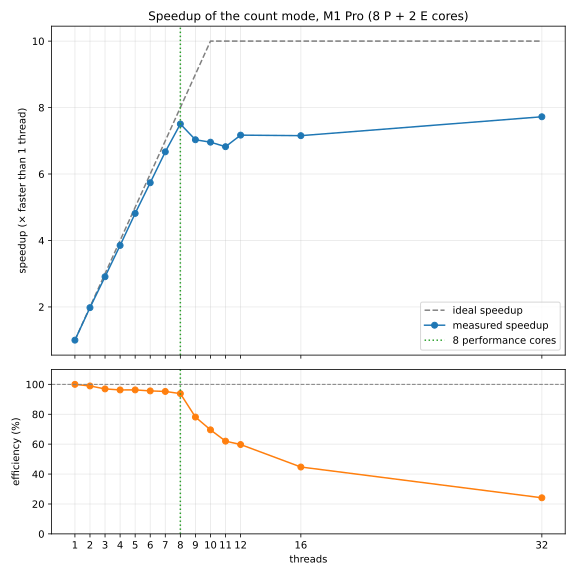

# Measurements

Every optimisation in this project is measured against the previous version, so its effect can be shown rather than assumed. This file records how the measurements are taken and what they show.

## Method

| Aspect | Choice | Reason |
|---|---|---|
| Tool | [Google Benchmark](https://github.com/google/benchmark) v1.10.0, fetched by CMake | The standard library for C++ micro-benchmarks, from the same team as GoogleTest. It repeats each measurement until it is stable and reports the spread. |
| Build | Release, with `-DIBAN_BUILD_BENCHMARKS=ON` | Debug code is not optimised; its timings do not represent the real program. |
| Workload | Count mode on `[0, 10⁸)` with `m = 11`, for 1 to 12, 16 and 32 threads | Large enough that starting threads is negligible next to the work. Every count up to 12 shows where all cores are in use; 16 and 32 show more threads than cores. |
| Time | Wall-clock time (`UseRealTime`) | The default CPU time only covers the calling thread, which just waits for the workers. Wall-clock time is what the user waits. |
| Repeats | 5 repetitions, median reported | One slow run (another program using the CPU) does not distort the result. The coefficient of variation (cv) shows how stable the runs were. |
| Correctness | Checked by the unit tests (`ParallelCount.MatchesSequentialForEveryThreadCount`) | A benchmark measures time only; correctness is the job of the tests. |
| Conditions | Laptop on mains power, other programs closed | Battery saving and background load change the clock speed. |

**Speedup** = median time with 1 thread / median time with p threads.
**Efficiency** = speedup / p; 100% means every thread does useful work all the time.

### Commands

```bash
cmake --preset release -DIBAN_BUILD_BENCHMARKS=ON
cmake --build --preset release
./build/release/iban_benchmark --benchmark_repetitions=5 --benchmark_report_aggregates_only=true
```

Use the `real_time_median` rows; the `CPU` column is the time of the waiting main thread and is not used.

## Machine

| | |
|---|---|
| Computer | Apple M1 Pro |
| Cores | 10: 8 performance cores and 2 efficiency cores (`sysctl hw.perflevel0.physicalcpu hw.perflevel1.physicalcpu`) |
| Compiler | AppleClang 21.0.0 |
| Date | 2026-11-13 |

The benchmark also prints the number of CPUs and the cache sizes at the top of its output.

## Step 4: parallel count, one result slot per thread

### First measurement (2026-11-13, thread counts 1, 2, 4, …, 32)

Measured with background load (load average about 12), so the numbers are somewhat pessimistic.

| Threads | Median (ms) | cv | Speedup | Efficiency |
|---:|---:|---:|---:|---:|
| 1 | 579 | 1.9% | 1.00 | 100% |
| 2 | 294 | 0.4% | 1.97 | 98% |
| 4 | 153 | 2.5% | 3.78 | 95% |
| 8 | 88.2 | 5.6% | 6.56 | 82% |
| 16 | 90.8 | 7.0% | 6.38 | 40% |
| 32 | 90.4 | 6.2% | 6.40 | 20% |

The chart compares the measured speedup with the ideal speedup (equal to the number of threads, at most 10 cores):



**Legend:** blue line = measured speedup; orange line = ideal speedup.

### Second measurement (2026-11-13, thread counts 1 to 12, 16 and 32)

Measured with less background load (load average about 6) and every thread count from 1 to 12, so the effect of the two kinds of cores is visible.

| Threads | Median (ms) | cv | Speedup | Efficiency |
|---:|---:|---:|---:|---:|
| 1 | 608 | 5.0% | 1.00 | 100% |
| 2 | 298 | 2.0% | 2.04 | 102% |
| 3 | 202 | 3.3% | 3.01 | 100% |
| 4 | 150 | 0.6% | 4.05 | 101% |
| 5 | 121 | 2.8% | 5.02 | 100% |
| 6 | 101 | 1.4% | 6.02 | 100% |
| 7 | 88.0 | 1.7% | 6.91 | 99% |
| 8 | **78.2** | 1.8% | **7.77** | 97% |
| 9 | 85.7 | 2.7% | 7.09 | 79% |
| 10 | 84.0 | 1.8% | 7.24 | 72% |
| 11 | 87.3 | 4.9% | 6.96 | 63% |
| 12 | 89.5 | 4.0% | 6.79 | 57% |
| 16 | 81.6 | 3.7% | 7.45 | 47% |
| 32 | 82.8 | 5.2% | 7.34 | 23% |

The chart compares the measured speedup with the ideal speedup (equal to the number of threads, at most 10 cores):



**Legend:** blue line = measured speedup; orange line = ideal speedup.

### Observations

- **Linear speedup up to 8 threads.** Up to the 8 performance cores, the efficiency stays near 100%: the threads share nothing while they run, so they do not wait for each other. Values just above 100% are within the measurement spread (cv up to 5%).
- **8 threads is the fastest (78 ms, 7.8×), not 10.** With 9 or 10 threads the program becomes *slower*, although there are 10 cores.
- **Cause: equal parts on unequal cores.** The range is split into equal parts, as the assignment requires. With 9 or more threads, some parts run on the 2 efficiency cores, which are considerably slower. The count is finished only when the slowest thread is finished, so these parts determine the total time.
- **16 and 32 threads are faster than 9 to 12.** With more threads than cores, the parts are smaller, and the operating system moves threads between cores; a thread that lands on an efficiency core holds up less work. Still no gain over 8 threads, because there are no more fast cores.
- **Conclusion:** a fair static split is optimal for identical cores. On a processor with performance and efficiency cores, the best thread count here is the number of performance cores. Dynamic work distribution (many small tasks taken by whichever thread is free) would balance unequal cores; this is investigated with the thread pool.
- **First measurement:** with more background load (load average about 12) the speedup at 8 threads was 6.6×; with less load it is 7.8×. Background load clearly affects the results, so conditions are recorded with every measurement.

## Figures for the report

The Mermaid charts above are rendered by GitHub, but Mermaid cannot draw markers, dashed lines or a real legend. For the report, `tools/plot_speedup.py` draws the conventional figure from the raw benchmark output: measured speedup with markers, the ideal speedup as a dashed line, the number of performance cores, and the efficiency below it.

```bash
# Save the raw results next to the console output:
./build/release/iban_benchmark --benchmark_repetitions=5 --benchmark_report_aggregates_only=true \
    --benchmark_out=docs/data/step4-count.json --benchmark_out_format=json

# Draw the figure (once: python3 -m venv .venv && .venv/bin/pip install -r tools/requirements.txt):
.venv/bin/python tools/plot_speedup.py docs/data/step4-count.json \
    --output docs/figures/step4-speedup.svg --performance-cores 8 \
    --title "Speedup of the count mode, M1 Pro (8 P + 2 E cores)"
```



The JSON file is committed with the figure, so the figure can always be redrawn from the measured data.

## Runs in CI

Every pull request also builds the benchmark and runs each thread count once (`benchmark (smoke run)` in the CI workflow). This only checks that the benchmark still builds and runs. The results are shown as a table on the Summary page of the run and kept as the artifact `benchmark-ubuntu` (JSON), but they are **indicative only**: CI runners are shared virtual machines with few cores and varying hardware, so their timings are not used for the conclusions in this file.

## References

The benchmark follows the official Google Benchmark documentation. After a build with `-DIBAN_BUILD_BENCHMARKS=ON`, the documentation of the exact version used is also available locally in `build/release/_deps/googlebenchmark-src/docs/`.

| Topic | Source | Used for |
|---|---|---|
| Basic structure, CMake integration | [Google Benchmark README](https://github.com/google/benchmark#readme), sections *Usage* and *Usage with CMake* | `benchmark::State`, the measuring loop, `BENCHMARK_MAIN`, `FetchContent` |
| Thread counts as arguments | [User Guide](https://github.com/google/benchmark/blob/main/docs/user_guide.md), *Passing Arguments* | `Range(1, 32)` with `RangeMultiplier(2)` |
| Wall-clock time for code that starts threads | User Guide, *CPU Timers* | `UseRealTime()`: the default CPU timer only measures the main thread |
| Keeping the work from being optimised away | User Guide, *Preventing Optimization* | `benchmark::DoNotOptimize` |
| Repetitions, median and spread | User Guide, *Statistics: Reporting the Mean, Median and Standard Deviation* | `--benchmark_repetitions`, `--benchmark_report_aggregates_only` |
| Stable measurements | [Reducing Variance](https://github.com/google/benchmark/blob/main/docs/reducing_variance.md) | The *Conditions* row of the method |
| Why the speedup levels off | [Amdahl's law](https://en.wikipedia.org/wiki/Amdahl%27s_law) | Interpreting the observations |
| Measuring C++ code in general | Chandler Carruth, *Tuning C++: Benchmarks, and CPUs, and Compilers! Oh My!*, CppCon 2015 | Background on benchmarks and `DoNotOptimize` |